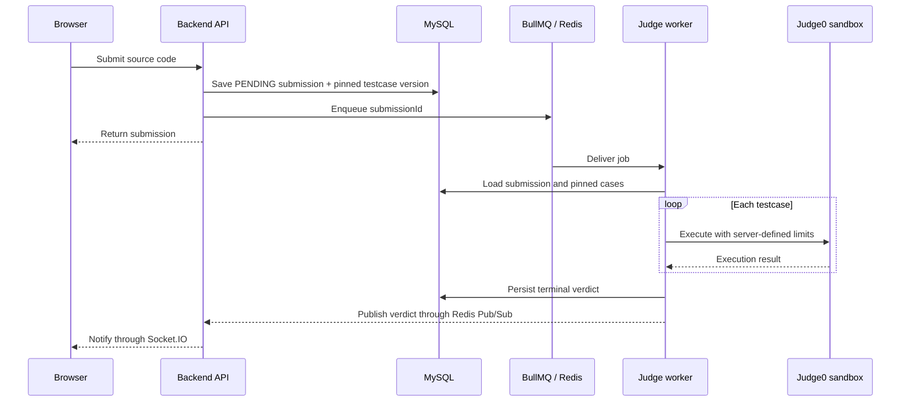

<div align="center">
  
  <h1>Fessior</h1>
  <p><strong>An online judge built for asynchronous judging and realtime competition.</strong></p>
  <p>
    <a href="https://fessior.duckdns.org">Live demo</a> ·
    <a href="docs/architecture.md">Architecture</a> ·
    <a href="docs/main-features.md">Feature guide</a> ·
    <a href="docs/deployment.md">Deployment</a>
  </p>
  <p>
    
    
    
    
    
  </p>
</div>

Fessior is a portfolio project focused on the backend challenges behind an online judge: safely importing versioned testcases, processing submissions asynchronously, running untrusted code through Judge0, and coordinating realtime 1v1 matches. A small React client makes those flows easy to explore.

> **Demo availability:** the live demo runs on a self-managed Azure VM and may be offline when the VM is stopped.

## Engineering highlights

| Flow | What happens |
| --- | --- |
| **Versioned testcase imports** | Admins upload a ZIP. The backend validates its structure and cases before activating a new testcase set. Each submission pins the active version so later imports do not change an in-flight or historical judgment. |
| **Persistent asynchronous judging** | The API stores a `PENDING` submission before enqueueing a BullMQ job containing only its ID. The Judge worker reloads the pinned data, applies guarded state transitions, stores the verdict, then publishes a realtime update. |
| **Sandboxed execution** | The application delegates submitted source code to Judge0/isolate. The server controls language and execution options; the API and worker do not execute user code inside their own process. |
| **Realtime results and recovery** | Socket.IO delivers updates, while MySQL remains the source of truth. If a client disconnects or misses an event, it can reload submission or match state through the API. |
| **Realtime 1v1 matchmaking** | Redis coordinates the matchmaking queue. Match actions check participant membership, and a database compare-and-set settles the first accepted submission and ELO changes once. |

## How a submission is judged



**Judge** is Fessior's BullMQ background worker. **Judge0** is the separate execution service that runs submitted code in an isolate sandbox.

## Technology

- **Applications:** React, Vite, TypeScript, Express, Socket.IO
- **Persistence and jobs:** MySQL 8, Prisma, Redis 7, BullMQ
- **Execution:** Judge worker, `packages/executor`, Judge0 1.13.0 / isolate
- **Local and production infrastructure:** Docker Compose, Nginx, Caddy

## Run locally

### Prerequisites

- Node.js with npm 10.9.2
- Docker Desktop or Docker Engine with the Compose plugin

### Start the development stack

```powershell
Copy-Item .env.example .env
npm install
npm run dev
```

On macOS or Linux, use `cp .env.example .env` for the first command. `npm run dev` starts the local infrastructure, prepares Prisma and shared packages, applies migrations, then starts the frontend, backend, and judge workspaces.

| Service | Local address |
| --- | --- |
| Frontend | <http://localhost:5173> |
| Backend API | <http://localhost:6868> |
| Judge0 (hybrid development profile) | <http://localhost:2358> |

The checked-in `.env.example` provides local development values. Keep real credentials in your ignored `.env`; replace the sample secrets before sharing or deploying an environment. For database setup, tests, and troubleshooting, see the [development guide](docs/development.md).

## Repository map

```text
apps/
├── frontend/       # React web client and demo flows
├── backend/        # REST API, Socket.IO, persistence, and queue producer
└── judge/          # BullMQ worker that delegates execution to Judge0
packages/
├── contracts/      # Shared queue, API, and realtime contracts
└── executor/       # Judge0 client and result normalization
infra/              # Local and production Compose, Judge0, and Caddy config
docs/               # Architecture, flow, development, security, and deployment guides
```

## Technical guides

- [System architecture](docs/architecture.md)
- [Main features](docs/main-features.md)
- [Local development and verification](docs/development.md)
- [Secure testcase ZIP ingestion](docs/testcase-ingestion.md)
- [Asynchronous judging pipeline](docs/judging-pipeline.md)
- [Sandbox security and known limits](docs/sandbox-security.md)
- [Realtime 1v1 matchmaking](docs/realtime-1v1.md)
- [Production deployment](docs/deployment.md)

## Production deployment

Production uses a separate Compose stack and `scripts/deploy.sh`; the local `npm run dev` workflow remains independent. The deployment guide covers the Azure VM setup, environment configuration, HTTPS, updates, and SSH access.
